# cuda-simd-axpy

Group 6 Members:
- Gabrielle Joei V. Bactong
- Catherine Gunita
- Shirley Lobo
- Diane Benedict Panganiban

## Project Specifications
The kernel is to perform vector AXPY on vectors $A$ and $B$, placing the result in vector $Z$.

**Input**: Scalar variable $n$ (integer) contains the length of the vector; scalar variable $x$ (single-precision float). Vectors $A$
and $R$ are single-precision floats.

**Process**: $Z_i = a •X; + Y;$ for $i = 0,1,...,n - 1$

**Output**: store the result in vector $Z$. Display the execution time. the first 5. and the last 5 elements of vector $Z$ for verification across all 4 kernels.

**Variants**: (1) a C/C++ program version (2) a CUDA program version using a grid-stride loop without prefetch and without mem advise (3) a CUDA program version using a grid-stride loop with prefetching but without page creation and without mem advise (4) a CUDA program version using a grid-stride loop with prefetch, with page creation but without mem advise (5) a CUDA program version using a grid-stride loop with prefetch, with page creation and with mem advise. For each kernel, execute at least 30 times.

## i) Screenshot of program output with execution time for all cases
**SIMD**

Figure 1. SIMD 2^20

Figure 2. SIMD 2^24

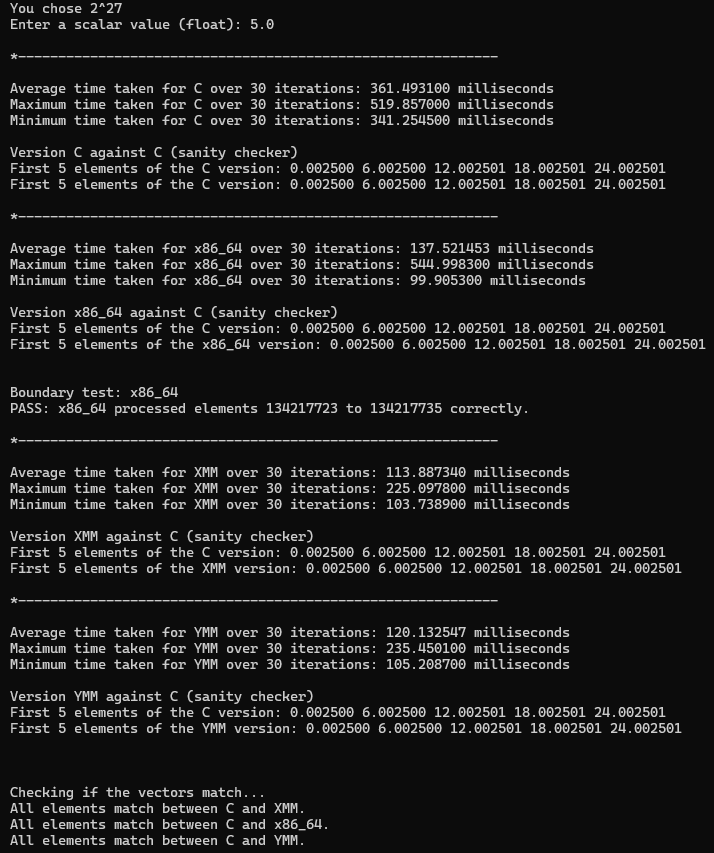

Figure 3. SIMD 2^27

**C Kernel Output**

Figure 4. C kernel output

**CUDA with Grid-stride Loop and without prefetch, page creation, and memory advise**

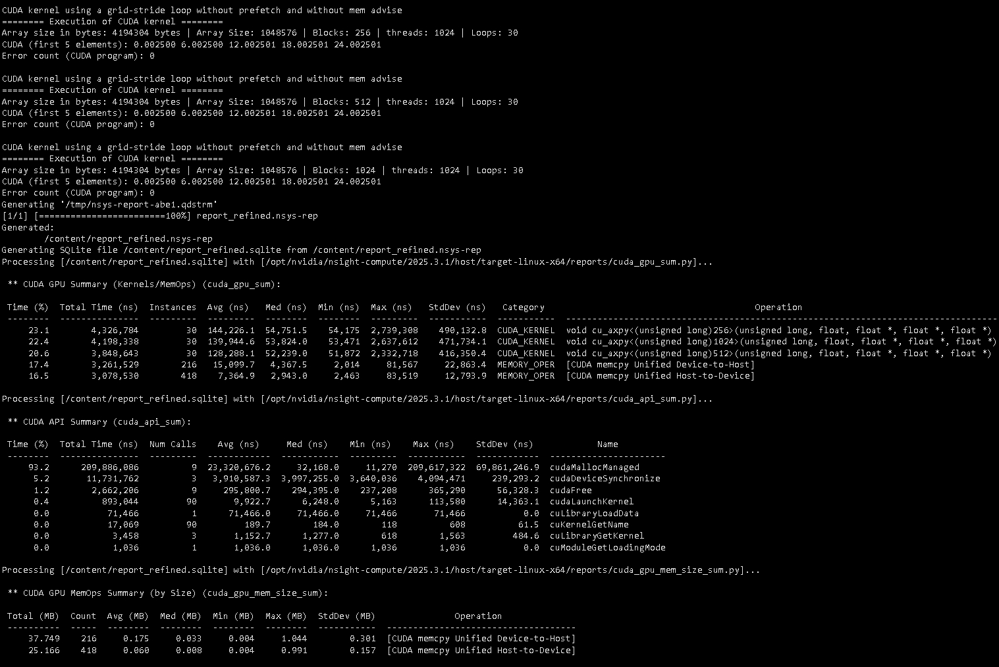

Figure 5. CUDA with Grid-stride Loop and without prefetch, page creation, and memory advise (Array Size: 2^20, Block Size: 256, 512, 1024) 

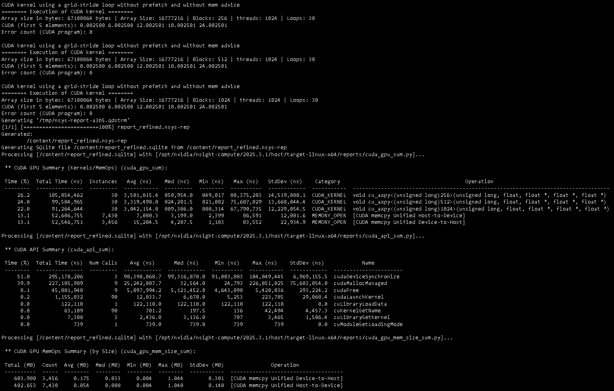

Figure 6. CUDA with Grid-stride Loop and without prefetch, page creation, and memory advise (Array Size: 2^24, Block Size: 256, 512, 1024) 

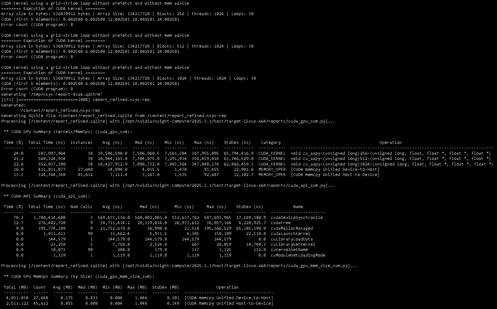

Figure 7. CUDA with Grid-stride Loop and without prefetch, page creation, and memory advise (Array Size: 2^27, Block Size: 256, 512, 1024) 

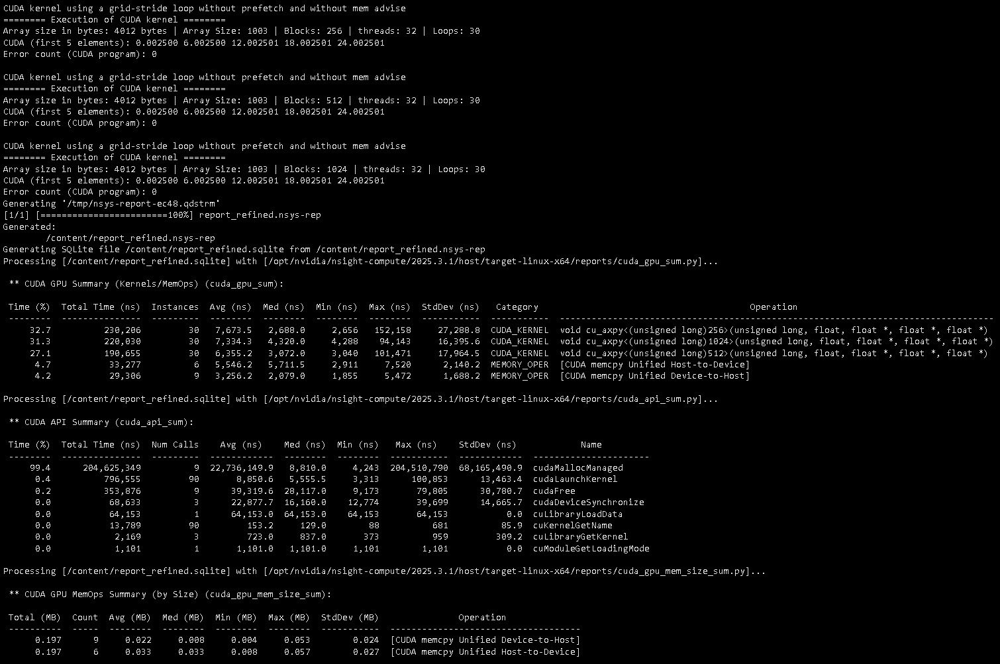

Figure 8. CUDA with Grid-stride Loop and without prefetch, page creation, and memory advise (Array Size: 1003, Block Size: 256, 512, 1024) 

**CUDA with Grid-stride Loop and prefetch and without page creation and memory advise**

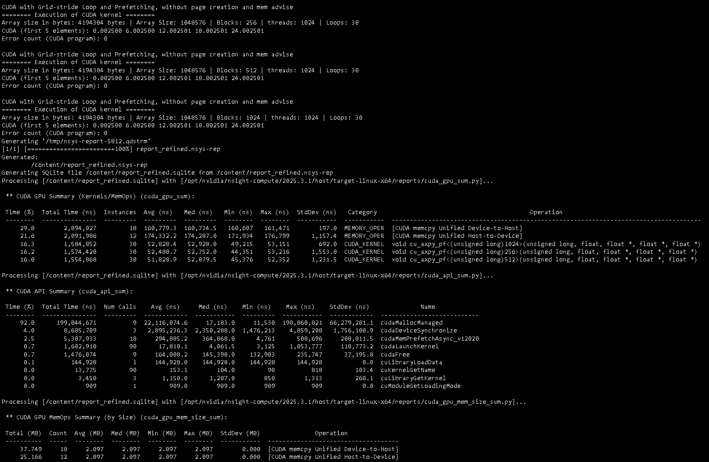

Figure 9. CUDA with Grid-stride Loop and prefetch and without page creation and memory advise (Array Size: 2^20, Block Size: 256, 512, 1024) 

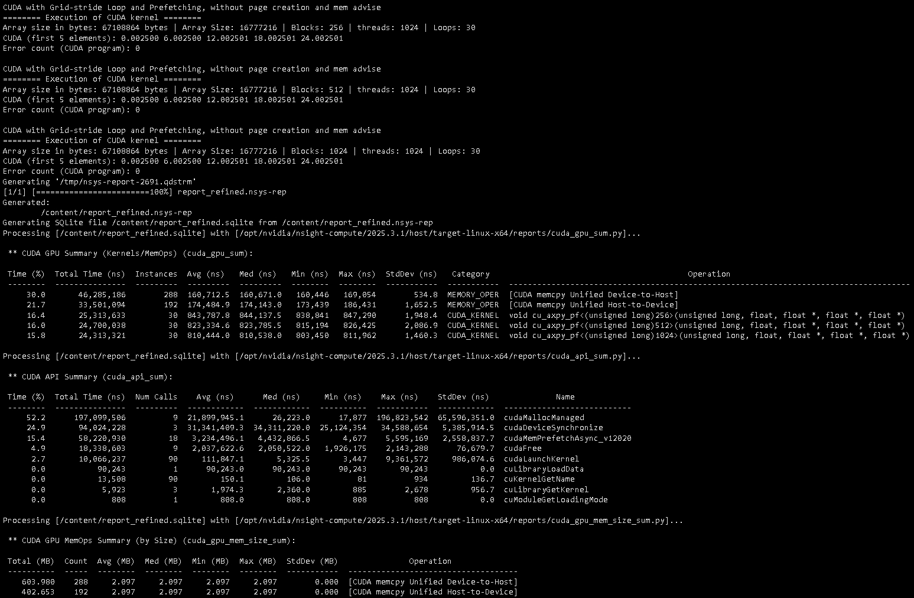

Figure 10. CUDA with Grid-stride Loop and prefetch and without page creation and memory advise (Array Size: 2^24, Block Size: 256, 512, 1024) 

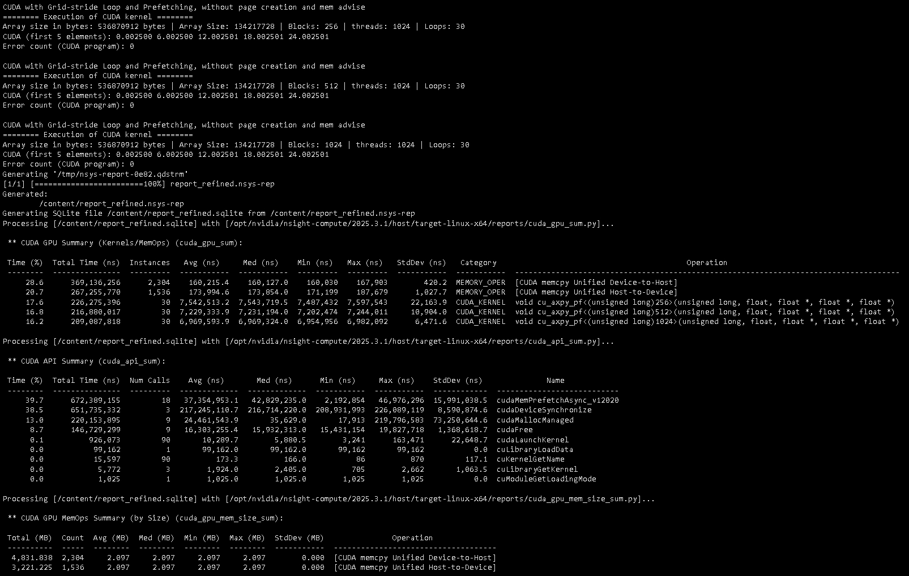

Figure 11. CUDA with Grid-stride Loop and prefetch and without page creation and memory advise (Array Size: 2^27, Block Size: 256, 512, 1024) 

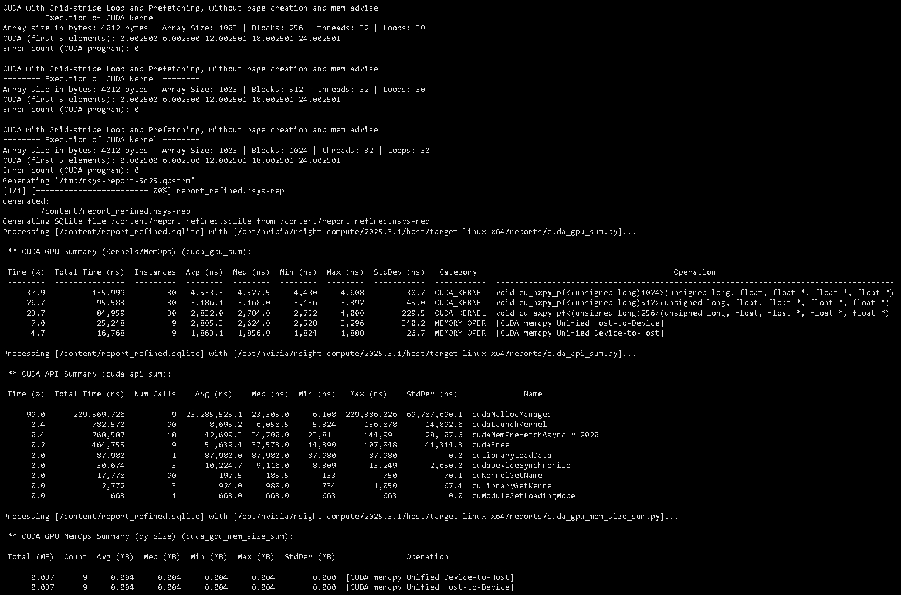

Figure 12. CUDA with Grid-stride Loop and prefetch and without page creation and memory advise (Array Size: 1003, Block Size: 256, 512, 1024) 

**CUDA with Grid-stride Loop, prefetch, and page creation and without memory advise**

Figure 13. CUDA with Grid-stride Loop, prefetch, and page creation and without memory advise (Array Size: 2^20, Block Size: 256, 512, 1024) 

Figure 14. CUDA with Grid-stride Loop, prefetch, and page creation and without memory advise (Array Size: 2^24, Block Size: 256, 512, 1024) 

Figure 15. CUDA with Grid-stride Loop, prefetch, and page creation and without memory advise (Array Size: 2^27, Block Size: 256, 512, 1024) 

Figure 16. CUDA with Grid-stride Loop, prefetch, and page creation and without memory advise (Array Size: 1003, Block Size: 256, 512, 1024) 

**CUDA with Grid-stride Loop, prefetch, page creation, and memory advise**

Figure 17. CUDA with Grid-stride Loop, prefetch, page creation, and memory advise (Array Size: 2^20, Block Size: 256, 512, 1024) 

Figure 18. CUDA with Grid-stride Loop, prefetch, page creation, and memory advise (Array Size: 2^24, Block Size: 256, 512, 1024) 

Figure 19. CUDA with Grid-stride Loop, prefetch, page creation, and memory advise (Array Size: 2^27, Block Size: 256, 512, 1024) 

Figure 20. CUDA with Grid-stride Loop, prefetch, page creation, and memory advise (Array Size: 1003, Block Size: 256, 512, 1024) 

## ii) Comparative Table

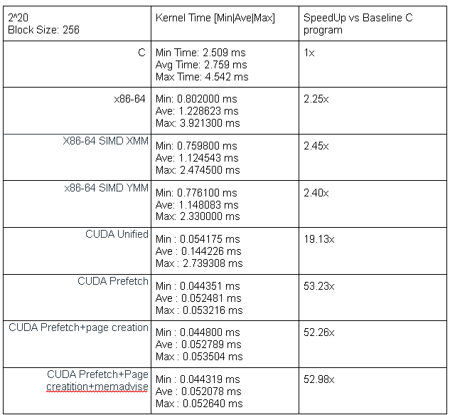

Figure 21. Comparative Table (Array Size: 2^20 Block Size: 256)

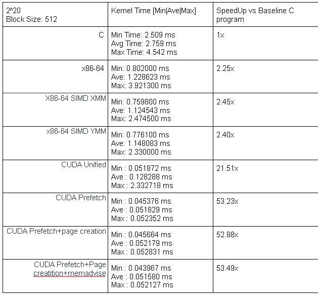

Figure 22. Comparative Table (Array Size: 2^20 Block Size: 512)

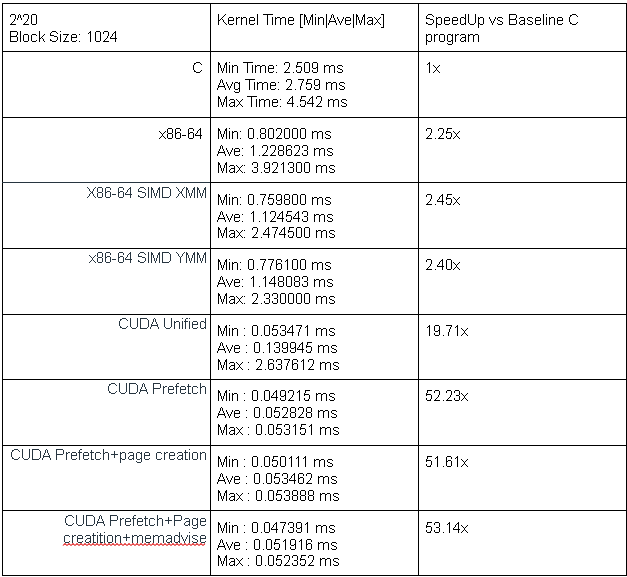

Figure 23. Comparative Table (Array Size: 2^20 Block Size: 1024)

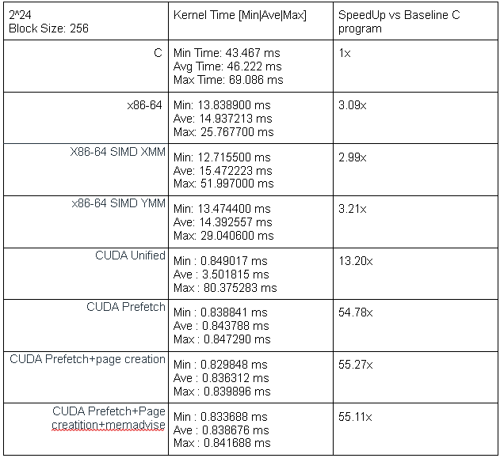

Figure 24. Comparative Table (Array Size: 2^24 Block Size: 256)

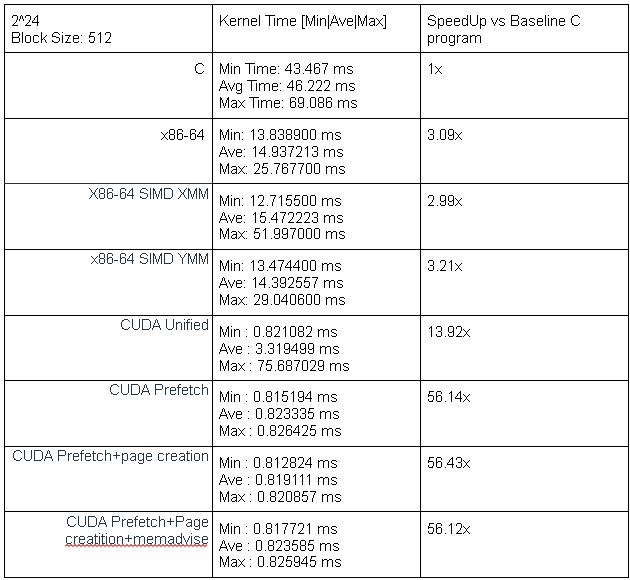

Figure 25. Comparative Table (Array Size: 2^24 Block Size: 512)

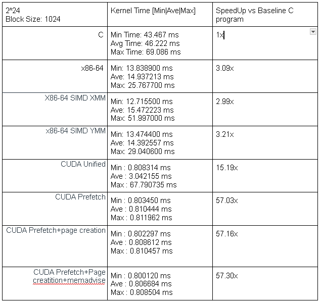

Figure 26. Comparative Table (Array Size: 2^24 Block Size: 1024)

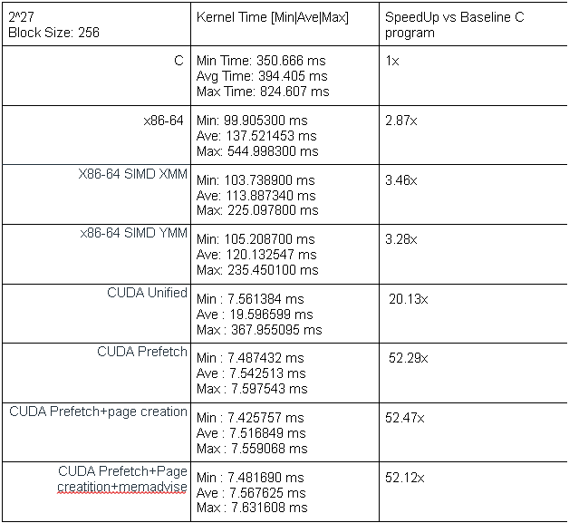

Figure 27. Comparative Table (Array Size: 2^27 Block Size: 256)

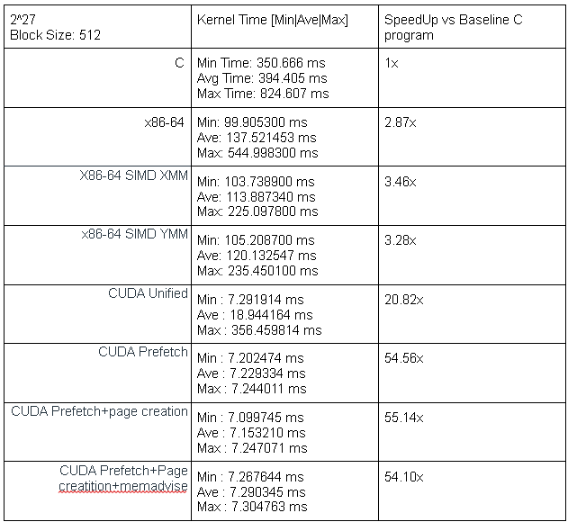

Figure 28. Comparative Table (Array Size: 2^27 Block Size: 512)

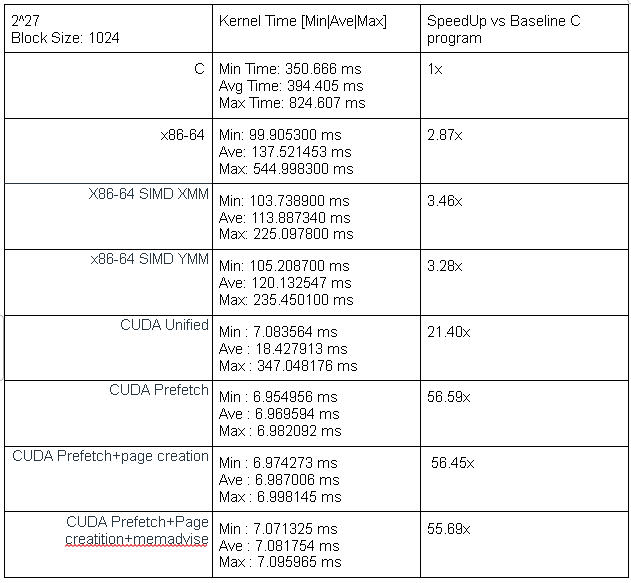

Figure 29. Comparative Table (Array Size: 2^27 Block Size: 1024)

### iv.) Analysis of Results

#### Analysis of kernel execution time

Testing the execution time for vector sizes $2^{20}$, $2^{24}$, and $2^{27}$ was observed to follow a similar trend compared to the Baseline C program. For this reason, this section of the analysis will focus on the execution time across all kernels at vector size $2^{24}$. All analyses made for vector size $2^{24}$ should apply to $2^{20}$ and $2^{27}$. 

First, we briefly discuss the speedup between C, x86-64, and the SIMD kernels. Among all kernels, it can be said that the XMM and YMM versions constantly outperforms the C version. This is because the XMM and YMM kernels can perform one AXPY calculation for 4 or 8 floats at the same time, which reduces the number of instructions needed to process the same amount of data. In a similar way, x86-64 is faster than C because it allows direct hardcoding to CPU registers without depending on a compiler. The execution time between C, and the x86-64 and SIMD kernels will remain constant throughout the analysis for vector size $2^{24}$. The C, x86-64, and SIMD kernels for vector sizes $2^{20}$ and $2^{27}$ follow the same execution time trend, whereas x86-64, XMM, and YMM versions are faster than C. However, the assembly kernels still only rely on the CPU. 

Next, we move on to the analysis of execution time of the CUDA kernels wherein the GPU is finally utilized for parallel processing. The CUDA unified memory without prefetching version is observed to have a 3.04ms to 3.50ms average execution time. However, the maximum execution time is observed to be significantly greater than the minimum execution time (i.e. 67ms-80ms from 0.80ms-0.84ms) because of the cost of demand-page faulting when relying on only unified memory. The first iteration of the kernel sequentially transfers individual page faults instead of one contiguous block, interrupting the GPU repeatedly and increasing the maximum latency spikes.

Thus, implementing CUDA memory prefetching reduces the average execution time to 0.81ms to 0.84ms, delivering  a 54.78x to 57.03x speedup. CUDA memory prefetching eliminates the maximum latency spikes and moves the needed data to GPU memory before kernel launch instead of transferring them during execution sequentially. Meanwhile, implementing page creation and memory advice alongside memory prefetching allows the programmer to directly handle and specify memory allocations, allowing the CPU or GPU to access the same memory location without having to “cut” data and checking access and synchronization permissions. 

All observations across vector sizes follow the same trend discussed above.

#### Analysis of speed performance across all platforms

Upon gradually increasing the block size from 256 to 1024, it was observed that the speedup of each CUDA variant increases as the block size is increased. To be exact, the speedup increase from a block size of 256 to a block size of 1024 was observed to be 1.15x, 1.04x, 1.03x, and 1.03x for kernels CUDA unified memory, CUDA prefetch, CUDA prefetch with page creation, and CUDA prefetch with page creation and memadvise, respectively. In a grid-stride loop implementation, this is because increasing the block size to 256, 512, and 1024 improves the latency of the kernel because more active warps are available during execution. However, it is also important to note that more blocks does not always equal higher speedup. Small block sizes do not efficiently occupy the maximum allowed number of active threads and can introduce more overhead. However, large block sizes may leave no room for other blocks, limiting occupancy. For this case, the recommended block size given this collection of speedups is a block size of 1024 while implementing prefetch, page creation, and memadvise. The speedup is massive compared to the fastest speed up we acquired from the SIMD platform of 3.21x, racking up a speedup between the platforms of 17.77x. 

Though, if it were compared to a CUDA variant of just CUDA unified and the fastest speedup among the SIMD platform, the speedup only goes up to about 5.08x. While this is still fast, this proves the importance of recommending an always prefetching approach. If CUDA is always managing the memory, it drastically reduces the speedup. A sample can be taken directly from the variant of CUDA unified against the CUDA prefetch testing against a block size of 1024, the speedup is observed to be 3.75x. This same pattern of increasing the speedup can be observed in all SIMT of varying block sizes, insinuating the importance of implementing prefetching. 

In this case, SIMT is faster than SIMD. SIMT executes scalar code across independent threads while SIMD executes vector operations simultaneously in one instruction (See section vi for further explanation). However, it is not always the case that SIMT is faster than SIMD, as SIMD can be faster for programs with low latency. 

### v.) Problems Encountered, Methodology, and AHA Moments

#### Problem 1: Floating-Point Precision and Validation Errors

**Problem Encountered**

During the validation of the CUDA AXPY implementation, we encountered approximately 6,850,695 mismatched results when processing a vector containing \(N = 2^{24}\) (16,777,216) elements. The issue was associated with the limitations of single-precision floating-point arithmetic, particularly when working with large numerical values and small fractional increments.

A 32-bit `float` has 24 bits of significand precision, including the implicit leading bit, providing approximately 7 decimal digits of precision. As the vector indices increased, the spacing between representable floating-point values also increased. Consequently, small fractional values such as `0.0025f` would be lost when added to values in the millions. Differences in CPU and GPU floating-point calculations may have also contributed to the errors.

**Methodology and Investigation**

We examined the vector initialization and result-validation procedures in `helpers.h` to identify the possible causes of the mismatched outputs. The investigation focused on the numerical range of the input vectors, the precision limitations of the `float` data type, and the tolerance used when comparing expected and computed results. The original validation approach compared the absolute difference between the expected and actual results against a fixed tolerance. However, this approach can become overly restrictive for large floating-point values, where the magnitude of rounding error may increase with the magnitude of the computation.

**Solution Implemented**

We implemented a relative error tolerance instead of a fixed absolute tolerance when validating the results. This approach adjusts the acceptable difference based on the magnitude of the expected value, accounting for floating-point rounding differences at different numerical scales and improving the reliability of result validation.
   
---

#### Problem 2: Separating CUDA Kernel Configurations for Profiling

**Problem Encountered**

During performance profiling, we encountered difficulties organizing and distinguishing the execution results of different CUDA kernel configurations. Since the implementation involved multiple block configurations, profiling them through repeated NVIDIA Nsight Systems (`nsys`) commands became repetitive and inconvenient. Running multiple configurations within the same program also made it more difficult to identify which profiling results corresponded to each configuration. This complicated the analysis of kernel execution behavior and the comparison of different block sizes.

**Methodology and Investigation**

We investigated how to organize the CUDA implementation so that individual configurations could be profiled without repeatedly modifying the source code or manually executing separate profiling commands. With the assistance of AI-based debugging and code suggestions, we explored C++ template specialization as a way to separate the execution paths of different kernel configurations. The approach involved defining template-based functions and using explicit specializations through `template<>` to distinguish the configurations during execution and profiling.

**Solution Implemented**

We applied C++ template specialization to organize the CUDA execution configurations into separate, identifiable functions. This allowed the different block configurations to be represented through distinct execution paths while retaining the same underlying AXPY computation. As a result, the configurations could be distinguished more clearly in NVIDIA Nsight Systems profiling output. This reduced the need to repeatedly invoke `nsys` through separate Bash commands and made the profiling workflow more organized.

## vi) Difference between SIMT and SIMD in handling Parallelism

SIMD (Single Instruction, Multiple Data) and SIMT (Single Instruction, Multiple Threads) are both approaches to parallel computing, but they differ in how instructions and data are processed.

SIMD executes a single instruction on multiple data elements simultaneously using vector registers. For example, a 128-bit XMM register can process four single-precision floating-point values, while a 256-bit YMM register can process eight. This allows CPUs to perform the same operation on multiple elements using fewer instructions compared to scalar processing (Intel, n.d.). In our project, we implemented a conventional C version of the AXPY operation as the CPU baseline.

SIMT, on the other hand, executes multiple threads that follow the same instruction sequence on different data elements. In our CUDA implementation, each GPU thread processes vector elements independently using its assigned thread index. Threads are organized into blocks within a grid, allowing the GPU to execute many threads concurrently. Threads within a warp generally execute instructions together, although different execution paths may occur when branching is involved (NVIDIA, n.d.-a).

We implemented a grid-stride loop in our CUDA kernels to support vector sizes larger than the total number of threads launched in the grid. Each thread calculates its starting index using `blockIdx.x`, `blockDim.x`, and `threadIdx.x`, then advances by the total number of threads in the grid until all assigned elements have been processed. This allows each thread to process multiple vector elements without requiring a separate thread for every element.

In our AXPY operation, both the CPU and GPU implementations perform the same computation:

`Z[i] = a * X[i] + Y[i]`

#### Advantages and Disadvantages in Our Use Case

| Approach | Advantages | Disadvantages |
| --- | --- | --- |
| **SIMD** | Processes multiple data elements per vector instruction, making it efficient for repetitive numerical computations. Can improve CPU performance without requiring GPU memory management or kernel launches. | Performance depends on the CPU instruction set, vector width, and compiler optimization. Explicit SIMD programming requires consideration of data alignment, vectorization, and remaining elements. |
| **SIMT** | Supports large numbers of concurrent GPU threads, making it suitable for highly parallel workloads. Grid-stride loops allow flexible processing of different vector sizes. CUDA also provides memory-management techniques such as prefetching and memory advice. | Requires GPU kernel launches and memory management. Data migration between CPU and GPU memory may introduce overhead. Performance can also depend on block configuration, memory access patterns, and GPU hardware. |

These differences are consistent with Intel's description of SIMD vector instructions and NVIDIA's explanation of GPU thread execution and memory optimization (Intel, n.d.; NVIDIA, n.d.-a; NVIDIA, n.d.-b).

#### Observations from the AXPY Implementation

Based on our implementation, the CPU baseline and CUDA SIMT approach demonstrate two different ways of executing the same AXPY computation. The CPU implementation uses a sequentially expressed C loop, while the CUDA implementation distributes the workload across multiple GPU threads.

Our CUDA implementation also explores different memory-management strategies through four kernel variants: baseline Unified Memory, memory prefetching, prefetching with page creation, and prefetching with page creation and memory advice. These variants allow us to investigate how data placement and memory migration may affect GPU execution.

Additionally, the CUDA implementation uses grid-stride loops and experiments with different grid configurations, including 256, 512, and 1024 blocks. This demonstrates how thread organization and memory-management strategies can be adjusted without changing the underlying AXPY computation.

Overall, SIMD and SIMT both provide ways to exploit data parallelism. SIMD achieves this through vector instructions operating on multiple data elements, while SIMT distributes operations across multiple threads. In our project, the conventional C implementation serves as the CPU baseline, while CUDA demonstrates explicit SIMT parallelism and provides opportunities to investigate GPU memory-management optimizations.

## AI USAGE DECLARATION 
Generative AI was not used in the development of the kernels outlined in this project aside from the debugging of the problems encountered stated in section v.

## References

Harris, M. (2013, March 18). *CUDA pro tip: Write flexible kernels with grid-stride loops*. NVIDIA Technical Blog. https://developer.nvidia.com/blog/cuda-pro-tip-write-flexible-kernels-grid-stride-loops/

Intel. (n.d.). *Intel® 64 and IA-32 architectures software developer's manual*. Intel Corporation. https://www.intel.com/content/www/us/en/developer/articles/technical/intel-sdm.html

NVIDIA. (n.d.-a). *CUDA C++ programming guide*. NVIDIA Corporation. https://docs.nvidia.com/cuda/cuda-c-programming-guide/

NVIDIA. (n.d.-b). *CUDA C++ best practices guide*. NVIDIA Corporation. https://docs.nvidia.com/cuda/cuda-c-best-practices-guide/
