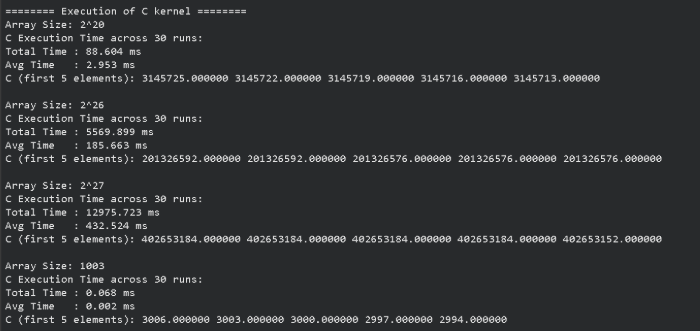
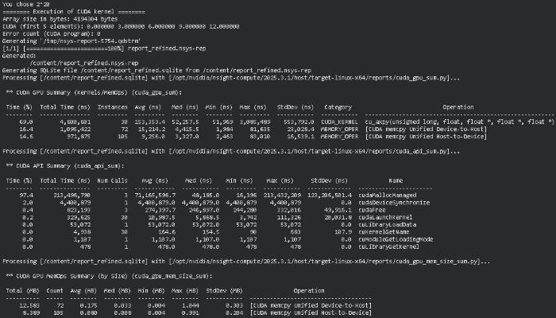

# cuda-simd-axpy

Group 6 Members:
- Gabrielle Joei V. Bactong
- Catherine Gunita
- Shirley Lobo
- Diane Benedict Panganiban

## Project Specifications
The kernel is to perform vector AXPY on vectors $A$ and $B$, placing the result in vector $Z$.

**Input**: Scalar variable $n$ (integer) contains the length of the vector; scalar variable $x$ (single-precision float). Vectors $A$
and $R$ are single-precision floats.

**Process**: $Z_i = a •X; + Y;$ for $i = 0,1,...,n - 1$

**Output**: store the result in vector $Z$. Display the execution time. the first 5. and the last 5 elements of vector $Z$ for verification across all 4 kernels.

**Variants**: (1) a C/C++ program version (2) a CUDA program version using a grid-stride loop without prefetch and without mem advise (3) a CUDA program version using a grid-stride loop with prefetching but without page creation and without mem advise (4) a CUDA program version using a grid-stride loop with prefetch, with page creation but without mem advise (5) a CUDA program version using a grid-stride loop with prefetch, with page creation and with mem advise. For each kernel, execute at least 30 times.

### i) Screenshot of program output with execution time for all cases

## AI USAGE DECLARATION 
Generative AI was not used in the development of the kernels outlined in this project.
